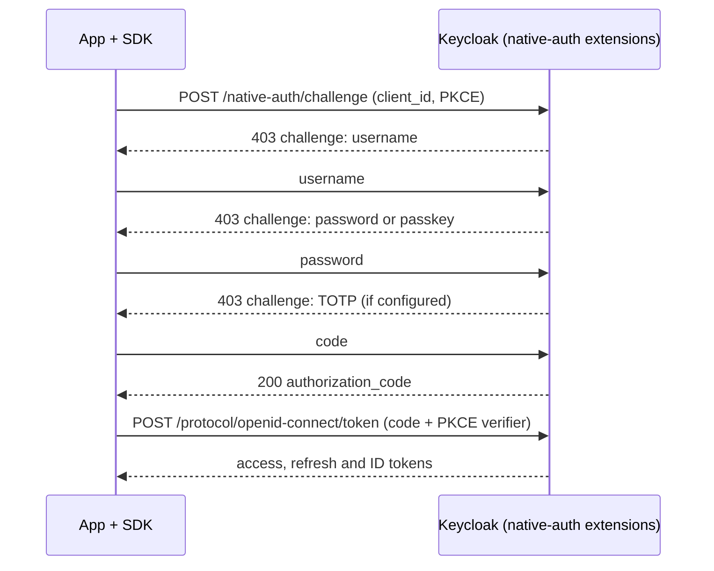

Native applications are installed on a device, such as a phone, a tablet or a desktop computer. Like any other application, a native app gets a client in Keycloak and signs users in with OpenID Connect. The app is a _public_ client: it can't keep a secret, so it proves each login with PKCE instead. There are two good ways to build the login itself:

- **Native login** with Phase Two's [native authentication for Keycloak](https://github.com/p2-inc/native-apps). The app signs users in with its own screens, and Keycloak still runs the authentication flow and decides what the user has to do. SDKs are available for iOS, Android, React Native and Flutter.
- **Browser-based login** with a library such as [AppAuth](https://appauth.io/). The app opens Keycloak's login page in the system browser, and the browser hands the result back to the app. This works with any Keycloak and needs no extensions.

## How native login works

Phase Two's Keycloak extensions add a challenge endpoint to each realm, modeled on the IETF draft [OAuth 2.0 for First-Party Applications](https://datatracker.ietf.org/doc/draft-ietf-oauth-first-party-apps/). When the app starts a login, Keycloak runs an authentication flow you configure, and instead of rendering a login page it returns each step as a JSON challenge: a username, a password, a passkey assertion, a one-time code, a push approval. The SDK shows a native screen for each challenge and sends the answer back until Keycloak returns an authorization code, which the SDK exchanges for tokens at Keycloak's standard token endpoint with PKCE.

Because Keycloak is still running the flow, the settings you already rely on keep applying: conditional second factors, brute-force protection, required actions, and levels of authentication for step-up. You change the login in Keycloak, not in the app. Steps the native flow can't serve, such as a required action without a native version, hand the login to the system browser for that one sign-in.

The [launch post](/blog/native-login-keycloak-ios-android) explains why we built it.

## Comparison

| | Native login (Phase Two SDKs) | Browser-based login (AppAuth) |
| --- | --- | --- |
| Login screens | The app's own screens: default SwiftUI, Jetpack Compose, React Native and Flutter screens you can replace one at a time | Keycloak's login pages in a browser sheet, themed to match the app |
| First thing the user sees | Your login screen | On iOS, a system prompt that the app "wants to use" the Keycloak domain to sign in, then the web page |
| Server requirements | Phase Two's native authentication extensions on Keycloak 26.4 to 26.8 | Any Keycloak |
| Platforms | iOS 17+, Android 9+ (API 28), React Native 0.84+, Flutter 3.35+ | iOS, macOS, Android and more |
| Sign-in methods | Native username, password, passkey, TOTP, email and SMS codes, recovery codes and push approval with number matching | Every Keycloak authenticator |
| Required actions | Update password, verify email (by code), accept terms, register a passkey and enroll for push run in the app; others open the browser | All, in the browser |
| Registration, password reset, social and enterprise IdP login | In the browser | In the browser |
| Browser single sign-on | No: a native login doesn't create a browser session | Yes: the browser can reuse an existing Keycloak session |
| Token storage | Keychain or Android Keystore, handled by the SDK | Up to the app |
| DPoP token binding | Built in, with a hardware-backed key where the device has one | Not built into AppAuth |
| Maturity | Below 1.0; APIs may change between releases | Mature and widely used |
| License | SDKs Apache 2.0; Keycloak extensions [Elastic License 2.0](https://www.elastic.co/licensing/elastic-license) | Apache 2.0 |

## Which should I choose?

- **Choose native login** when the login is part of your product's experience: you want your own screens, passkeys and push approvals that feel like part of the app, no browser sheet or iOS consent prompt, and step-up for sensitive actions. It's for _first-party_ apps, the apps you publish yourself, because the app sees what the user types.
- **Choose browser-based login** when you can't add extensions to your Keycloak, when you rely on authenticators or identity providers that only run in the browser for most of your users, when several apps (or the app and your website) should share one browser session, or when the app belongs to a third party.
- **Mixing is fine.** A native-login app still uses the browser for registration, password reset and social login, and the client settings for both approaches can live on the same Keycloak client.

## Why not the password grant or an embedded webview?

**The password grant** (Resource Owner Password Credentials) has the app post the username and password straight to the token endpoint. It only handles passwords, it bypasses the login flow you configure, so passkeys, push approvals, required actions and most second factors can't work, and it trains users to type their password wherever they're asked. The [OAuth 2.0 Security Best Current Practice (RFC 9700)](https://datatracker.ietf.org/doc/html/rfc9700) says it must not be used, and OAuth 2.1 removes it. Native login gives you the same "our own screens" experience while Keycloak still runs the full flow.

**An embedded webview** (`WKWebView`, Android `WebView`) that loads Keycloak's login page looks like browser-based login but isn't. The app controls the webview, so it can read everything the user types and every cookie; the user has no address bar to check; the session isn't shared with the system browser; and passkey support is limited there, while some identity providers, Google among them, block sign-in from webviews altogether. [OAuth 2.0 for Native Apps (RFC 8252)](https://datatracker.ietf.org/doc/html/rfc8252) requires the system browser instead. If you want the login inside the app, use native login; if you want the browser, use the system browser through AppAuth.

## Guides

Native login:

- [Server setup](./server-setup.md): install the extensions, create the native flow and the client, and configure DPoP, passkeys and push.
- [iOS](./ios.md): the Swift package with SwiftUI screens.
- [Android](./android.md): the Kotlin libraries with Jetpack Compose screens.
- [React Native](./react-native.md): the TurboModule with React screens and an Expo config plugin.
- [Flutter](./flutter.md): the plugin with Flutter widgets.

Browser-based login:

- [Browser-based login with AppAuth](./browser-login.md): the Keycloak client setup for AppAuth on iOS, macOS and Android.

On Phase Two hosted Keycloak, [contact us](/contact) to have the native authentication extensions enabled on your cluster.
