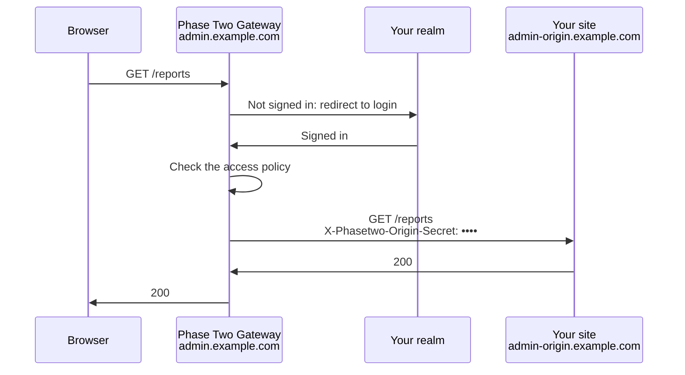

:::info Preview
Gateway is being rolled out. It appears under each realm in the dashboard once it is enabled for
your account. Ask [support@phasetwo.io](mailto:support@phasetwo.io) if you want to try it.
:::

**Gateway puts your realm's login in front of that website without changing it.** You point
the site's hostname at Phase Two. Visitors sign in with the same Keycloak realm, identity
providers, MFA and policies as the rest of your applications, and then Phase Two forwards their
requests to your site. Your site doesn't have to know anything about OIDC.

## How it works

Two hostnames are involved:

- The **public hostname**, such as `admin.example.com`, is where your users go. You point it at
  Phase Two with a CNAME.
- The **origin**, such as `https://admin-origin.example.com`, is where your site actually runs.
  Gateway forwards requests to it.

Requests only reach your site through Gateway if your site refuses everything else. Phase Two
generates an **origin secret** for each app and sends it on every request it forwards. Your site,
or the load balancer in front of it, must reject requests that don't carry it. Gateway checks
that your site does this before it lets you go live.

## What Gateway is, and what it is not

Gateway is:

- **A managed, authenticating reverse proxy** for browser traffic to websites you run. There is
  nothing to deploy or keep up to date.
- **Your realm's login.** Users sign in with whatever the realm already supports: passwords,
  passkeys, social login, your customers' SSO and MFA. Each app gets its own OIDC client in the
  realm, created for you.
- **Path-level access control.** Allow any signed-in user, or require realm roles, client roles,
  groups or claims for specific paths and methods.
- **A source of identity for your site, if you want one.** Gateway can send the user's ID, email,
  groups and roles as headers, and a short-lived signed JWT your site can verify.

Gateway is not:

- **A way to reach private networks.** Your origin must be reachable from the internet over HTTPS,
  with a valid certificate. Gateway does not tunnel into a VPC or an office network.
- **Protection for a site that answers without the secret.** Anyone who finds your origin's
  address can skip the login unless the origin requires the secret. Gateway verifies that it does,
  but only your site can enforce it.
- **A login for API clients.** Gateway authenticates browsers with a session cookie. It drops
  `Authorization` headers rather than passing them on, and answers unauthenticated non-browser
  requests with `401`. Machine-to-machine APIs should validate Keycloak access tokens themselves.
- **Forward auth for your own proxy.** It is a full proxy, not an `auth_request` endpoint for
  nginx, Traefik or Envoy.
- **A firewall.** It doesn't inspect request bodies or filter attacks, and it doesn't replace
  authorization inside your site beyond the path rules you give it.
- **For WebSockets, yet.** Upgrade requests are refused with `501`.

If you are building a new application, or one that needs to know a lot about the user, use an OIDC
library instead. See [Securing Applications](../securing-applications/index.md).

## Before you start

You need:

- A realm on a dedicated cluster, and the realm's owner or the `manage-clusters` organization role.
- A **hostname you control** for users to visit, such as `admin.example.com`. It needs a CNAME,
  so use a subdomain rather than a bare domain like `example.com`.
- Your site running at a **different hostname** over HTTPS, with a certificate from a public CA,
  on port 443 or 8443. It must resolve to a public IP address.
- A **page on your site to verify against**, such as `/healthz`, which returns a `2xx` with the
  secret present and has no side effects.
- Access to your site's ingress (nginx, a load balancer, or the application itself) to make it
  require the secret. [Protecting an existing application with Gateway](../securing-applications/gateway.md)
  has examples.

## Put an app behind Gateway

### 1. Add the app

In the [dashboard](https://dash.phasetwo.io/), open your cluster, choose the realm, and select
**Gateway**. Select **Add app** and fill in:

| Field                 | Example                            | Notes                                                                                       |
| --------------------- | ---------------------------------- | ------------------------------------------------------------------------------------------- |
| **Name**              | `Internal admin console`           | Shown in the dashboard.                                                                     |
| **Public hostname**   | `admin.example.com`                | Where users go. Can't be changed later.                                                     |
| **Origin URL**        | `https://admin-origin.example.com` | Where your site runs. It may include a base path, such as `https://origin.example.com/app`. |
| **Verification path** | `/healthz`                         | Defaults to `/`.                                                                            |

Select **Create**. Phase Two creates the app's OIDC client in your realm, called
`gateway-admin.example.com`, generates the origin secret, and requests a certificate for the public
hostname.

### 2. Save the origin secret

The next screen shows the **origin secret**. **This is the only time you will see it.** Copy it
into your secrets manager or your ingress configuration now. If you lose it, rotate it; see
[Rotating the origin secret](#rotating-the-origin-secret).

The dialog also shows an nginx snippet with the secret filled in. Then select **I've saved it —
continue setup**.

The app's page lists four steps, and the app goes live when all four are done.

### 3. Require the secret at your origin

Configure your site, or its ingress, to answer **`401` or `403`** to any request whose
`X-Phasetwo-Origin-Secret` header is not exactly the secret. That applies to every path,
including static files.

Examples for nginx, Node and Python are in
[Protecting an existing application with Gateway](../securing-applications/gateway.md#1-require-the-origin-secret).

### 4. Verify the origin

Under **Origin admission verified**, select **Verify origin**. Phase Two sends four requests to
your verification path:

| Probe                                      | What your origin must answer |
| ------------------------------------------ | ---------------------------- |
| With the secret                            | `2xx`                        |
| Without the secret                         | `401` or `403`               |
| With a wrong secret                        | `401` or `403`               |
| With forged identity headers and no secret | `401` or `403`               |

The result is one of three:

- **Verified**: you can continue.
- **Origin accepts requests without the secret**: your site served a request that did not carry
  the secret. Anyone can bypass the login by going to the origin directly. Fix the ingress and
  verify again.
- **Inconclusive**: anything else, such as a `404`, a redirect, an error or a timeout. Check that
  the verification path exists and returns a `2xx` with the secret.

Each probe's status is shown, which usually points straight at the problem.

Verification is evidence rather than proof. It shows that this path refuses requests without the
secret. It can't see another route to your site that you didn't put behind the same check.

### 5. Point DNS at Gateway

Under **DNS and TLS ready**, the dashboard shows the CNAME to create: `admin.example.com` pointing
to the target shown. Create it at your DNS provider. If a TXT record is also listed, create it
too. It proves you control the hostname.

Certificate issuance usually takes a few minutes once the CNAME resolves. Select **Refresh** to
check.

### 6. Activate

Once the origin is verified and the hostname and certificate are ready, select **Activate**.
Gateway starts serving `https://admin.example.com` within a minute.

Select **Test sign-in** to open the site. You are sent to your realm's login page and then returned
to the page you asked for.

## Control who gets in

By default, anyone who can sign in to the realm can reach every path. To narrow that, use
**Access policy** on the app's page.

**Paths no rule matches** decides what happens to a path without a rule:

- **Any signed-in user** (the default).
- **Denied**: only paths a rule matches are reachable.

Each **rule** applies to a path prefix and, optionally, to particular methods. A rule either
**Requires** conditions — at least one of a list of realm roles, and at least one of a list of
groups — or **Denies** the path outright.

Two things about how rules combine:

- **Every rule that matches a request must pass.** A rule on `/` applies to every request, so it
  is a way to set a baseline for the whole site, not a fallback.
- **Prefixes match whole path segments, case-insensitively.** `/admin` matches `/Admin/users`, but
  not `/administrator`.

Some common shapes:

| Goal                                                | Paths no rule matches | Rules                                                      |
| --------------------------------------------------- | --------------------- | ---------------------------------------------------------- |
| Staff only                                          | Any signed-in user    | `/` requires group `/staff`                                |
| Everyone can read reports, admins can change things | Denied                | `/reports` for `GET`; `/admin` requires realm role `admin` |
| Hide a path entirely                                | Any signed-in user    | `/internal` denies                                         |

A user who signs in but fails the policy sees an "Access denied" page from Gateway. Your site never
receives the request.

The API and [Terraform provider](../management-api/terraform.md#gateway-apps) also accept client
roles and claim conditions, such as requiring a verified email.

## Send the user's identity to your site

Your site keeps working without any of this. If you want it to know who the user is, open
**Identity sent to your origin**:

- **Headers.** Choose any of `X-Phasetwo-Auth-User-Id`, `X-Phasetwo-Auth-Email`,
  `X-Phasetwo-Auth-Username`, `X-Phasetwo-Auth-Name`, `X-Phasetwo-Auth-Groups` and
  `X-Phasetwo-Auth-Roles`. Groups and roles are JSON arrays. Gateway removes any header starting
  with `X-Phasetwo-` that a browser sends, so these can't be forged through Gateway.
- **A signed identity assertion.** Gateway adds `X-Phasetwo-Auth-Assertion`, a JWT signed with
  ES256 that is valid for 60 seconds. It carries the user's `sub` and the claims you choose. The
  page shows the issuer and audience to validate it with.

Headers are a convenience. Your site can trust them only because it requires the origin secret.
Use the assertion to authenticate users from these values; see
[Use the user's identity](../securing-applications/gateway.md#3-use-the-users-identity).

## Sessions and signing out

Under **Sessions**, set how long a user stays signed in:

- **Idle timeout**: signed out after this long without a request. Defaults to 30 minutes.
- **Maximum session**: signed out this long after signing in, whatever they do. Defaults to 8 hours.

Your realm's own session limits also apply, and end sessions sooner if they are shorter.

Users sign out at `https://admin.example.com/_p2/logout`. It asks them to confirm, then ends both
the Gateway session and the Keycloak session. Afterwards they see a Phase Two page, or the URL you set as the post-logout
redirect. Paths under `/_p2/` belong to Gateway and are never forwarded to your site.

## Rotating the origin secret

Rotate the secret when someone who knew it leaves, if it may have leaked, or on a schedule. The
steps avoid downtime because your origin accepts both secrets during the change:

1. Under **Origin secret**, select **Rotate**. The new secret is shown once. Save it.
2. Configure your origin to accept **either** the current or the new secret.
3. Select **Verify new secret**.
4. Select **Promote**. Gateway starts sending the new secret immediately.
5. Remove the old secret from your origin.

## Deactivating and deleting

**Deactivate now** stops serving the app immediately, everywhere, and signs out every user. The
public hostname answers `503 Unavailable`. The configuration is kept, so you can activate it
again.

**Delete** deactivates the app, then removes its hostname and the OIDC client Phase Two created.
Remove the CNAME afterwards.

## Troubleshooting

| What you see                                                  | What it means                                                                                                                                   |
| ------------------------------------------------------------- | ----------------------------------------------------------------------------------------------------------------------------------------------- |
| Verification: **Origin accepts requests without the secret**  | The no-secret, wrong-secret or forged-identity probe got a response other than `401`/`403`. The ingress isn't checking the header on that path. |
| Verification: **Inconclusive** with a `404`                   | The verification path doesn't exist on the origin, or the origin URL's base path is wrong.                                                      |
| Verification: **Inconclusive** with a `3xx`                   | The path redirects, often to the site's own login page. Choose a path that returns `2xx`.                                                       |
| **DNS and TLS ready** doesn't complete                        | The CNAME is missing, or points somewhere else, or a proxy in front of the hostname hides it. Check with `dig CNAME admin.example.com`.         |
| Your frontend's `fetch` calls get `401` with `login_required` | The session ended. Browser navigations are sent to the login page, but other requests get `401` with a `login_url` to send the user to.         |
| `502 Bad gateway`                                             | The origin didn't respond, or its certificate isn't valid.                                                                                      |
| `400` "The request path is ambiguous"                         | The path contained an encoded `/` or `\`, which servers disagree about. Gateway refuses these rather than guess.                                |

## Automating it

Everything on this page is in the [Management API](/api/management/gateway) and the
[Terraform provider](../management-api/terraform.md#gateway-apps), including activation, which
verifies the origin and waits for DNS for you.
